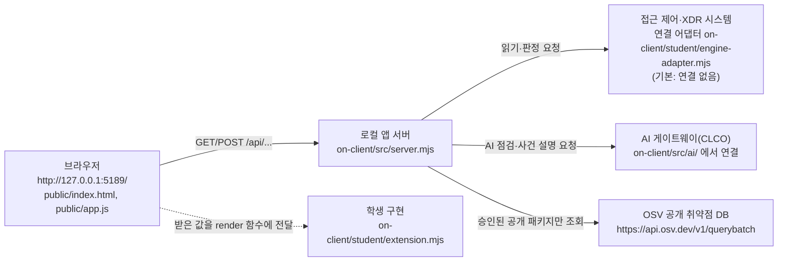

# 케셰브(Keshev) 학생용 실행 설명서와 시스템 구성도

이 문서는 학생이 직접 쓴 문서입니다. 제공 문서(`README.md`, `docs/STUDENT_LAUNCH_GUIDE.md` 등)는 고치지 않았습니다.
작성 기준: 이 저장소의 `on-client` 폴더, 시작 틀 `0.2.11`(`on-client/package.json`의 `version`).

문장 앞의 표시는 근거를 구분합니다.

- **[화면 확인]** 실제로 앱을 실행해 브라우저에서 직접 본 것
- **[코드 확인]** 파일을 읽어서 확인한 것(실행하지 않음)
- **[모의 확인]** 모의 데이터나 가짜 브라우저(jsdom)로 점검한 것
- **[미확인]** 확인하지 못한 것. 되는 것처럼 쓰지 않습니다.

## 1. 이 앱이 하는 일

케셰브는 회사 직원이 자기 로그인·기기·세션 상태, 업무 앱 접속 판정, 접속·XDR 기록, 보안 알림, AI 사건 설명, 조치 제안, 설치 패키지 취약점 조회 결과를 한 화면에서 보는 보안 Agent입니다. 13~22단계 동안 같은 프로젝트에 기능을 하나씩 더해 갑니다.

- 기본 실행은 실제 회사 시스템에 연결되지 않은 상태("연결 없음")입니다. [코드 확인: `src/engine.mjs`, `public/app.js`]
- `-Demo`로 실행하면 예제 자료로 화면을 채웁니다. 실제 연결이나 성취가 아닙니다. [화면 확인]
- 이 앱은 악성코드를 검사하거나 치료하지 않습니다. 서버가 알려 준 상태를 보여 줄 뿐입니다.

## 2. 필요한 프로그램과 확인한 버전

| 항목 | 기준 | 내가 실제로 확인한 값 |
|---|---|---|
| 운영체제 | Windows, PowerShell | Windows 10.0 계열 [화면 확인: 브라우저 요청 헤더의 `Sec-Ch-Ua-Platform: "Windows"`, `User-Agent: Windows NT 10.0`]. 세부 빌드는 [미확인] |
| Node.js | 수업 기준 24.19.0, 실행 도구는 22~24 허용 [코드 확인: `package.json`의 `engines`, `tools/start-alekov.ps1`] | v24.19.0 (직접 `node --version`으로 확인) |
| 브라우저 | 제한 없음 | Chrome 156 [화면 확인: `Sec-Ch-Ua`] |
| 외부 npm 패키지 | 없음 [코드 확인: `package.json`에 `dependencies` 없음] | 설치 단계 없음 |
| Git | 커밋·푸시에 사용 | 버전 [미확인] |

## 3. 폴더 구조

Git 저장소의 최상위는 `choi-bujang-secret-vault` 입니다. 케셰브는 그 안의 `on-client` 폴더입니다. [코드 확인]

```text
choi-bujang-secret-vault/        Git 최상위 (커밋은 여기서)
└─ on-client/                    앱 폴더 (실행은 여기서)
   ├─ package.json               이름 alekov-client-starter, 버전 0.2.11
   ├─ .env.example               비밀 없는 설정 견본
   ├─ src/server.mjs             로컬 앱 서버 (제공)
   ├─ src/engine.mjs             접속·XDR 엔진 연결 지점 (제공)
   ├─ src/ai/                    AI 연결·설명 (제공)
   ├─ src/vulnerabilities/       OSV 취약점 조회 (제공)
   ├─ public/index.html, app.js  브라우저 화면 (제공, 수정 금지)
   ├─ student/extension.mjs      학생이 구현한 화면 함수 (내가 고친 파일)
   ├─ student/engine-adapter.mjs 기존 서버 연결 어댑터 (제공)
   ├─ tools/start-alekov.ps1     실행 도구 (제공)
   └─ docs/STUDENT_RUNBOOK.md    이 문서
```

## 4. 실행 절차

### 4.1 PowerShell을 여는 위치

1. 파일 탐색기에서 `on-client` 폴더를 엽니다.
2. 주소 표시줄에 `powershell`을 입력하고 Enter를 누릅니다. 그러면 `on-client` 폴더에서 PowerShell이 열립니다.

작업 위치: 프로젝트 최상위 폴더 아래의 `on-client` 폴더(폴더의 PC 위치는 사람마다 다르므로 이 문서는 특정 경로에 의존하지 않습니다.)

### 4.2 예제 자료로 실행 (실제 연결 없음)

```powershell
powershell -NoProfile -ExecutionPolicy Bypass -File .\tools\start-alekov.ps1 -Demo
```

[화면 확인] 이 명령으로 앱을 실행해 브라우저에서 화면을 확인했습니다. 새 PowerShell 창에서 실행했을 때 아래 세 줄이 출력됐습니다. [화면 확인]

```text
케셰브 예제: http://127.0.0.1:5189
케셰브가 켜졌습니다. 브라우저에서 http://127.0.0.1:5189/ 을 여세요.
서버가 응답한 것만 확인했습니다. AI 연결 상태는 화면에서 따로 확인해 주세요.
```

그 뒤 `끄려면 이 창에서 Ctrl+C 를 누르세요.`가 함께 나옵니다.
`-ExecutionPolicy Bypass`는 이번 실행에만 적용되며 PC 설정을 바꾸지 않습니다. [코드 확인: 도구 설명]

### 4.3 실제 연결 없이 기본 실행

```powershell
powershell -NoProfile -ExecutionPolicy Bypass -File .\tools\start-alekov.ps1
```

연결 어댑터가 없으면 "연결 없음"으로 시작합니다. [코드 확인] 이 명령을 실행하면 아래 줄이 출력됐습니다(`-Demo`일 때의 `케셰브 예제:` 대신 `케셰브 연결 확인:`). [화면 확인: PowerShell 출력]

```text
케셰브 연결 확인: http://127.0.0.1:5189
```

이 상태에서 브라우저 위쪽에 "연결 없음" 표시가 나오고, 빨간 안내 상자에 `기존 서버·에이전트의 연결을 확인할 수 없습니다. 연결 어댑터를 먼저 확인하세요.`가 로그인 정보·업무 앱·보안 기록·기기·세션별로 나왔습니다. 학생 구현 칸(`renderIdentity`)에는 `연결 없음(disconnected)`과 `연결 실패: …`가 나왔습니다. [화면 확인]

`npm start`로도 같은 서버가 켜집니다. [코드 확인: `package.json`의 `scripts.start` = `node src/server.mjs`] 실행하면 `> alekov-client-starter@0.2.11 start`, `> node src/server.mjs`에 이어 `케셰브 연결 확인: http://127.0.0.1:5189`만 출력됐고, 브라우저에 같은 "연결 없음" 화면이 나왔습니다. `npm start`는 실행 도구가 아니라서 "케셰브가 켜졌습니다" 줄이 없고 Node.js 버전·포트 사전 확인도 하지 않습니다. [화면 확인]

`npm run demo`는 `node src/server.mjs --demo`와 같습니다. [코드 확인: `package.json`의 `scripts.demo`] 실행하면 `케셰브 예제: http://127.0.0.1:5189`가 출력되고, 브라우저 위쪽에 "예제 데이터(demo) · 실제 연결 아님"이 나왔습니다. [화면 확인]

### 4.4 브라우저 주소와 정상 시작 신호

- 주소: `http://127.0.0.1:5189/` (서버는 `127.0.0.1`에서만 듣습니다. [코드 확인: `src/server.mjs`의 `listen`])
- PowerShell에 아래 두 줄이 나오면 서버가 응답한 것입니다. [코드 확인: `tools/start-alekov.ps1`]
  - `케셰브가 켜졌습니다. 브라우저에서 http://127.0.0.1:5189/ 을 여세요.`
  - `서버가 응답한 것만 확인했습니다. AI 연결 상태는 화면에서 따로 확인해 주세요.`
- 브라우저에서 위쪽 상태 표시와 「보호 현황」이 보이면 화면이 뜬 것입니다. `-Demo`에서는 "예제 데이터(demo) · 실제 연결 아님"이 보입니다. [화면 확인]
- 서버가 응답했다는 것은 AI 연결이나 실제 시스템 연결 성공을 뜻하지 않습니다.

### 4.5 종료와 재실행

- 종료: 서버를 실행한 PowerShell 창에서 `Ctrl+C`를 누릅니다. [코드 확인: 도구 안내]
- 재실행: 같은 폴더에서 4.2의 명령을 다시 실행합니다.
- 포트 5189를 다른 프로그램이 쓰고 있으면 도구가 그 프로그램을 끄지 않고 멈춥니다. 다른 번호로 실행합니다. [코드 확인]

```powershell
powershell -NoProfile -ExecutionPolicy Bypass -File .\tools\start-alekov.ps1 -Demo -Port 5190
```

이때 브라우저 주소도 `http://127.0.0.1:5190/`로 엽니다. PowerShell에는 `케셰브 예제: http://127.0.0.1:5190`과 `케셰브가 켜졌습니다. 브라우저에서 http://127.0.0.1:5190/ 을 여세요.`가 출력됐습니다. [화면 확인: PowerShell 출력] `http://127.0.0.1:5190/`를 브라우저로 열면 "예제 데이터(demo) · 실제 연결 아님" 화면이 떴고, 5189번 서버를 동시에 켜 둔 상태에서도 두 서버가 각각 응답했습니다. [화면 확인]

### 4.6 문법만 확인

```powershell
npm run check
```

`student/extension.mjs`의 문법만 확인합니다. 화면이 맞는지는 확인하지 않습니다. [코드 확인: `package.json`의 `scripts.check`] 실행하면 `> alekov-client-starter@0.2.11 check`와 `> node --check student/extension.mjs`만 출력되고 오류 메시지가 없었습니다. [화면 확인: PowerShell 출력]

## 5. 시스템 구성도

### 5.1 Mermaid 구성도



### 5.2 글로 쓴 구성도

| 번호 | 구성 요소 | 실제 파일·주소 | 하는 일 | 확인 |
|---|---|---|---|---|
| 1 | 브라우저 | `http://127.0.0.1:5189/`, `on-client/public/index.html`, `on-client/public/app.js` | 화면을 그리고 `/api/...`를 호출합니다. 받은 값을 `student/extension.mjs`의 render 함수에 넘겨 학생 칸을 그립니다. | [화면 확인] |
| 2 | 로컬 앱 서버 | `on-client/src/server.mjs` | `127.0.0.1`에서만 듣고 브라우저 요청을 받아 아래 3~5로 전달합니다. 비밀 값은 브라우저로 보내지 않습니다. | [화면 확인: 서버가 화면과 `/api/vulnerabilities` 응답 `200 OK`를 제공] |
| 3 | 접근 제어·XDR 시스템 | `on-client/src/engine.mjs`, `on-client/student/engine-adapter.mjs` | 로그인·기기·세션·업무 앱·접속 판정·접속 기록을 읽습니다. 어댑터가 없으면 `ENGINE_NOT_CONNECTED`("연결 없음")입니다. | 연결 없음·예제 모드만 [화면 확인]. 실제 시스템 연결은 [미확인] |
| 4 | AI 게이트웨이(CLCO) | `on-client/src/ai/connection.mjs`, `on-client/src/ai/service.mjs` | 앱 안 AI 연결 점검과 사건 설명 요청을 중계합니다. 학생 프로젝트를 저장하는 곳이 아닙니다. | 실제 연결 성공은 [미확인] |
| 5 | OSV 공개 취약점 DB | `https://api.osv.dev/v1/querybatch`, `on-client/src/vulnerabilities/` | 담당자가 승인한 공개 패키지의 정확한 버전만 조회합니다. 허용 목록이 비어 있으면 조회하지 않습니다. | 조회하지 않는 상태(`not_configured`)만 [화면 확인]. 실제 OSV 조회 결과는 [미확인] |
| 6 | 학생 구현 | `on-client/student/extension.mjs` | `createStudentView()`가 render 함수들을 돌려줍니다. 서버·`public/app.js`는 이 파일만 불러옵니다. | [화면 확인] |

비밀(AI 열쇠·토큰·비밀번호)은 이 문서와 저장소에 적지 않습니다. 필요한 설정은 `.env` 같은 제출에서 빠지는 파일에만 둡니다. `.env.example`에는 비밀 없는 설정(`ON_PORT=5189` 등)만 있습니다. [코드 확인]

## 6. 제공 코드와 내가 구현한 부분

고친 파일은 `on-client/student/extension.mjs` 하나입니다. 아래 파일은 고치지 않았습니다: `public/app.js`, `public/index.html`, `src/` 전체, `tools/`, `student/engine-adapter.mjs`, 제공 문서. 서버·판정 코드·인증 설정도 그대로입니다.

| 단계 | 함수 | 화면의 학생 칸 | 하는 일 | 확인 방법 |
|---|---|---|---|---|
| 13 | `renderIdentity` | 학생 구현 표시 | 로그인 사용자·기기·세션을 상태 문구와 함께 보여 줍니다. 오류 때 이전 값을 남기지 않습니다. | [화면 확인: demo에서 사용자·기기·세션 표시를 봄] |
| 14 | `renderDecision` | 학생 구현 표시(판정) | 업무 앱 접속 판정(`allow`·`deny`·`challenge`·`unknown`)과 이유·시각을 보여 줍니다. | [모의 확인], 실제 화면은 이 문서에서 재확인하지 않음 |
| 15 | `renderEvents` | 학생 구현 표시(기록) | 접속·XDR 기록 목록과 상세, 필터를 보여 줍니다. 지원하지 않는 조치 버튼은 "<조치> 미지원"으로 비활성화합니다. | [모의 확인], 실제 화면은 이 문서에서 재확인하지 않음 |
| 16 | `renderStatus` | 학생 상태·알림 표시 | 기기·세션 상태, 알림, 빈 상태, 오류, 도움정보를 보여 줍니다. 비밀처럼 보이는 문구는 가립니다. | [모의 확인] |
| 17 | `renderAiConnection` | 학생 AI 연결 표시 | 앱 내부 AI 연결 점검 결과를 보여 줍니다. 자동으로 점검하지 않습니다. | [화면 확인: "AI 연결 점검 전" 표시]. 실제 AI 연결 성공은 [미확인] |
| 18 | `renderExplanation` | 학생 AI 사건 설명 | 선택한 사건의 AI 설명을 근거·규칙과 함께 보여 줍니다. 근거 없는 설명은 받아들이지 않습니다. | [모의 확인] |
| 19 | `renderAction` | 학생 조치 상태 표시 | 조치 제안과 서버 처리 결과를 상태별로 보여 줍니다. 효과 확인(`succeeded`)은 관측 결과가 있을 때만 표시합니다. 실제 조치는 실행하지 않았습니다. | [모의 확인(jsdom)] |
| 20 | `renderVulnerabilities` | 학생 패키지 조회 표시 | 설치 패키지 정확한 버전과 OSV 조회 결과를 보여 줍니다. 조회 실패·미조회를 "취약점 없음"으로 보이지 않게 합니다. | [화면 확인: demo에서 "조회 준비 미완료(not_configured)", 같은 값이 제공 카드와 학생 카드에 표시, `/api/vulnerabilities` 요청 `200 OK`] |

`renderIdentity` 외 나머지 render 함수는 화면 상단 탭 「보호 현황」「업무 앱」「보안 기록」에 나뉘어 있습니다. 구현 규칙은 모든 함수가 같습니다: DOM은 `createElement`와 `textContent`만 쓰고, 색뿐 아니라 글자로 상태를 구분하며, 이전 결과를 현재 결과처럼 남기지 않습니다. [코드 확인]

## 7. 오류별 확인 순서

화면이나 PowerShell에 나오는 문구와 확인 순서입니다. 문구는 코드에서 읽은 것입니다.

| 보이는 문구 | 원인(코드 기준) | 먼저 확인할 것 | 다음 확인 |
|---|---|---|---|
| `Node.js 가 없습니다` | Node.js가 설치되지 않았습니다. | `node --version`이 값을 출력하는지 | 설치 후 PowerShell 창을 새로 엽니다. |
| `지금 Node.js 는 vXX 입니다` | Node.js 버전이 22~24 범위 밖입니다. | `node --version` | 22~24, 권장 24.19.0을 설치합니다. |
| `포트 5189 를 다른 프로그램이 쓰고 있습니다` | 5189번 포트가 사용 중입니다. | 이미 실행 중인 케셰브 창이 있는지 | `-Port 5190`으로 실행하고 브라우저 주소도 바꿉니다. |
| `앱 폴더가 아닙니다` / `시작 틀 폴더가 아닙니다` | `on-client` 밖에서 실행했습니다. | PowerShell의 현재 위치 | `on-client`에서 다시 실행합니다. |
| `앱 서버가 20 초 안에 뜨지 않았습니다` | 서버가 시간 안에 응답하지 않았습니다. | 같은 창의 오류 메시지 | 메시지를 담당 강사에게 보여 줍니다. |
| 화면 위쪽 "연결 없음"과 빨간 상자 "기존 서버·에이전트의 연결을 확인할 수 없습니다. 연결 어댑터를 먼저 확인하세요." [화면 확인] | 연결 어댑터가 없습니다(`ENGINE_NOT_CONNECTED`). | 기본 실행인지(`-Demo` 없음) | 정상 상태입니다. 예제 화면은 `-Demo`로 봅니다. |
| "예제 데이터(demo) · 실제 연결 아님" | `-Demo` 실행입니다. | 실행 명령에 `-Demo`가 있는지 | 실제 연결 성공이 아닙니다. |
| "학생 구현 대기" | 해당 render 함수가 아직 구현되지 않았습니다. | `student/extension.mjs`가 저장됐는지 | 브라우저를 `Ctrl+F5`로 새로고침합니다. |
| `학생 구현 renderXxx 실행 중 오류가 발생했습니다` | 학생 함수에서 예외가 났습니다. | 브라우저 개발자 도구 Console | 해당 함수를 고치고 새로고침합니다. 제공 화면은 계속 동작합니다. |
| "학생 구현 ... 반환 형식이 DOM 요소 또는 텍스트가 아닙니다" | 함수가 요소·문자열이 아닌 값을 반환했습니다. | 해당 함수의 `return` | DOM 요소나 문자열을 반환합니다. |
| 패키지 조회 카드 "프로젝트 연결 준비 중"(`PROJECT_NOT_CONFIGURED`) | 조회 대상 프로젝트 설정이 없습니다. | `.env.example`의 `ON_PROJECT_DIRECTORY`가 비어 있는지 | 취약점이 없다는 뜻이 아닙니다. 대상 경로·허용 패키지는 운영자가 준비합니다. |
| 학생 카드 "조회 실패: 패키지 조회를 확인할 수 없습니다. 이전 결과를 정상으로 표시하지 않습니다."와 `오류 코드: NETWORK_ERROR` [화면 확인: 브라우저를 오프라인으로 바꾼 경우] | 요청 실패·시간 초과·응답 형식 불일치 중 하나입니다. | 표시된 오류 코드(`NETWORK_ERROR`, `TIMEOUT`, `CONTRACT_MISMATCH` 등) | 이전 표는 현재 결과가 아닙니다. 직접 **설치 패키지 조회**를 다시 누릅니다. 자동 재시도하지 않습니다. |
| `ENGINE_NOT_CONNECTED` | 접속·XDR 연결 어댑터가 없습니다. | 연결 설정이 준비됐는지 | 담당자 안내가 있을 때만 연결합니다. |
| AI 연결 칸 "AI 연결 점검 전" | 점검을 아직 누르지 않았습니다. | 제공 카드에서 연결 절차를 마쳤는지 | **AI 연결 점검**을 직접 누릅니다. 자동 점검하지 않습니다. |

## 8. 확인한 것과 확인하지 못한 것

### 8.1 실제 화면에서 확인한 것

- `-Demo` 실행으로 앱이 뜨고 `http://127.0.0.1:5189/`에서 화면이 열림
- 상단에 "예제 데이터(demo) · 실제 연결 아님" 표시
- 「보호 현황」에서 학생 구현 칸(보라색 줄, `student/extension.mjs · renderXxx` 표시)이 제공 카드와 구분되어 표시
- 설치 패키지 조회: 제공 카드는 "프로젝트 연결 준비 중", 학생 카드는 "조회 준비 미완료(not_configured)"로 같은 조회 시각을 표시
- 설치 패키지 조회 버튼을 누르면 `GET /api/vulnerabilities`가 나가고 `200 OK`가 돌아옴(개발자 도구 네트워크 탭)
- 개발자 도구에서 **Offline**으로 바꾸고 **설치 패키지 조회**를 누르면 요청이 `(failed) net::ERR_…`로 실패하고, 학생 카드가 "조회 실패: …"와 `오류 코드: NETWORK_ERROR`를 보여 주며 이전 `not_configured` 결과를 지움. 제공 카드도 같은 오류 코드를 표시
- **No throttling**으로 되돌리고 다시 누르면 `vulnerabilities` 요청이 새로 나가(`200 OK`) 학생 카드가 "조회 준비 미완료(not_configured)"로 돌아옴. 자동 재시도는 없고 직접 누를 때만 요청이 나감

### 8.2 기다림(UNV): 확인하지 못한 것

| 항목 | 상태 |
|---|---|
| 내 PC의 Node.js 정확한 버전 | v24.19.0 확인됨(직접 `node --version` 실행, 수업 기준과 같음) |
| 실제 접근 제어·XDR 시스템 연결(`connected`) | [미확인] |
| AI 게이트웨이(CLCO) 연결·승인 절차 완료와 실제 AI 사건 설명 | [미확인] |
| 조치 실행(`renderAction`의 서버 처리 결과) | 실행하지 않음. [미확인] |
| OSV 실제 조회 결과(패키지 행·취약점 ID), `package-lock.json` 버전과의 대조 | [미확인]. 허용 패키지 목록이 비어 있는 상태 |
| 조회 중 취소 뒤 늦은 응답이 다시 나타나지 않는지 | [미확인] |
| 1280px 이상 폭에서 키보드(Tab·Enter) 조작 점검 | [미확인] |
| Git 버전, 커밋·푸시 결과 | 이 문서에 적지 않음. 실제 결과는 `git log`와 포털 판정에서 확인 |

## 9. 지켜야 할 것

- 토큰·비밀번호·API 키·AI 열쇠를 코드, 커밋, 문서, 캡처, 도움정보에 넣지 않습니다.
- 제공 코드(`public/app.js`, `src/`, `tools/`)와 앞 단계 기능을 지우거나 덮어쓰지 않습니다.
- 제출은 서버가 문서의 명령을 직접 실행해 확인하는 것이 아니라, 제출한 커밋의 문서와 코드를 읽고 맞는지 판정하는 방식으로 알려져 있습니다. 문서의 명령은 학생이 직접 실행해 확인합니다. (공식 과제 화면 안내에는 "문서 명령 실제 실행"을 본다는 표현도 있어 두 설명이 다릅니다. 어느 쪽이든 이 문서는 실제로 실행한 것만 확인한 것으로 적습니다.)
